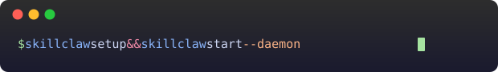
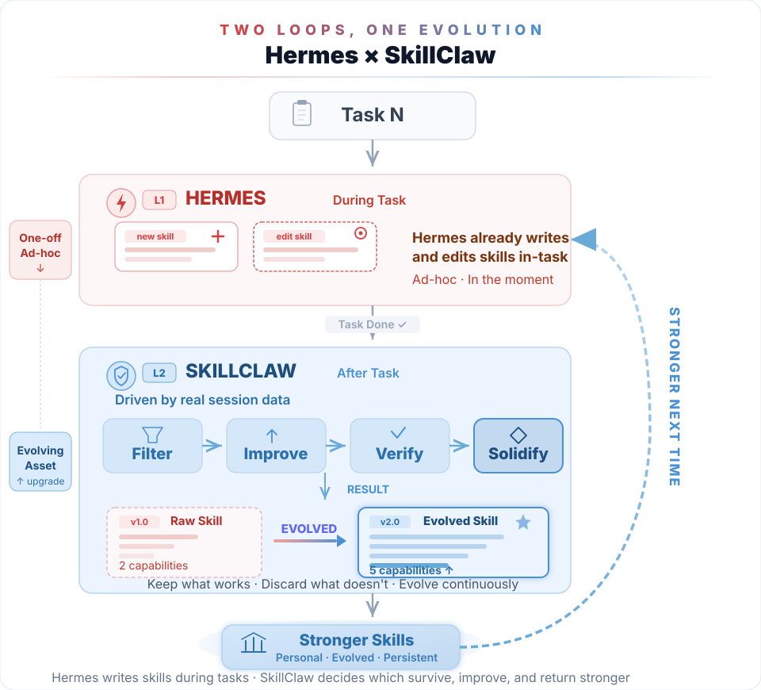
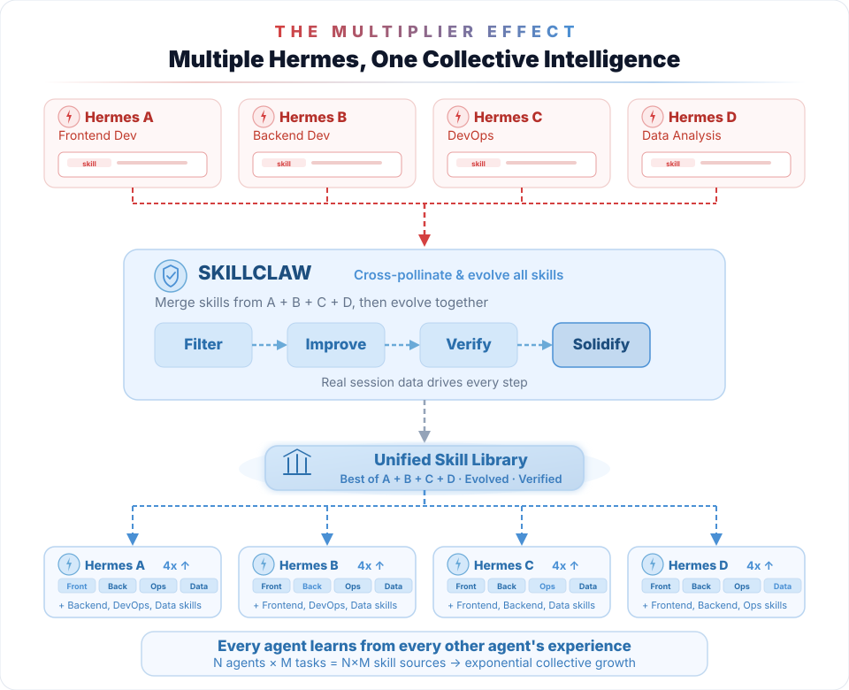
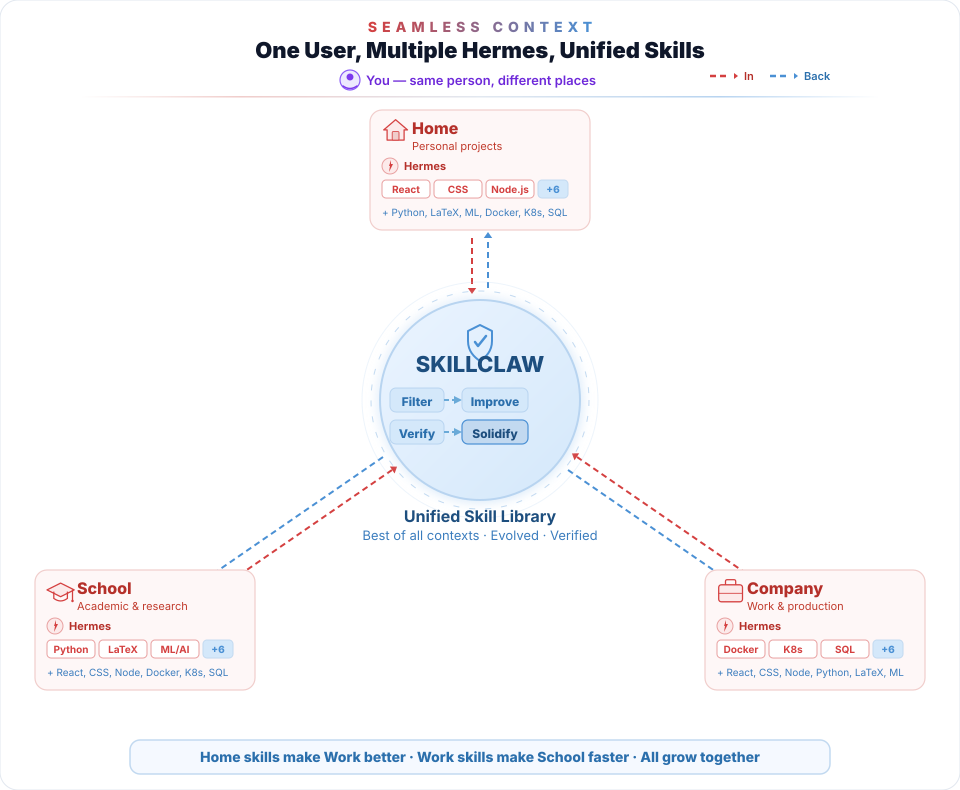
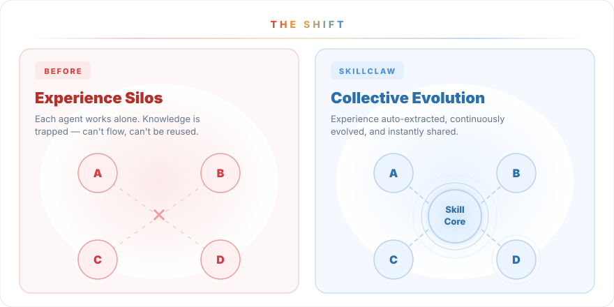
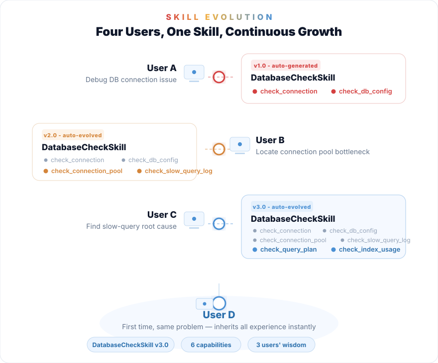

<div align="center">


# ✨ SkillClaw: Let Skills Evolve Collectively with Agentic Evolver ✨

<h3>让 AI Agent 技能从每一次真实交互中自动进化 —— 只需对话。<br>跨会话、跨 Agent、跨设备、跨用户，经验持续累积，技能群体进化。</h3>

| 🚀 安装快捷 | 💬 只需对话 | 🔌 广泛兼容 | 🧬 技能群体进化 |
|:-:|:-:|:-:|:-:|

[](https://github.com/NousResearch/hermes-agent)
[](https://github.com/openclaw/openclaw)
[](https://github.com/AMAP-ML/SkillClaw)
[](https://www.python.org/)
[](../LICENSE)
[](https://arxiv.org/abs/2604.08377)
[](https://arxiv.org/pdf/2604.08377)
[](https://huggingface.co/papers/2604.08377)
[](../README.md)

<br>

<a href="https://github.com/AMAP-ML/SkillClaw"></a>



</div>

<br>

<table>
<tr>
<td>🚀 <b>安装快捷</b></td>
<td>macOS/Linux 提供 shell 安装脚本；Windows 提供手动 Python 安装路径。安装后运行 <code>skillclaw setup</code> 和 <code>skillclaw start --daemon</code>。</td>
</tr>
<tr>
<td>💬 <b>只需对话</b></td>
<td>正常和 Agent 对话即可，Skill 的进化在后台无感完成，无需任何额外操作。</td>
</tr>
<tr>
<td>🔌 <b>广泛兼容</b></td>
<td>无缝支持 <a href="https://github.com/NousResearch/hermes-agent">Hermes</a>、<a href="https://github.com/openclaw/openclaw">OpenClaw</a>、QwenPaw、IronClaw、PicoClaw、ZeroClaw、NanoClaw、NemoClaw 及任何 OpenAI 兼容 API。</td>
</tr>
<tr>
<td>🧬 <b>技能群体进化</b></td>
<td>技能从每一次对话、每一个 Agent、每一个场景中进化。单人或团队，进化闭环完全一致。每一份经验都在累积。</td>
</tr>
</table>

---

<div align="center">

## SkillClaw 给一个 Hermes 用户带来了什么

</div>

Hermes 用久了，技能库是不是一锅乱炖？重复的、过时的、半成品的全挤在一起，像没人整理的掉落箱。问题不是学得不够多，而是没人帮它"消化"。

**SkillClaw 就是干这个的。** 自动进化、自动去重、自动提质。不改变你的使用方式，不打断你的节奏，只是悄悄改写 Agent 的成长曲线。

SkillClaw 不是让 Hermes 学更多，而是让它学到的一切，真正变成战斗力。

<div align="center">



</div>

这只是一个人的故事。一个用户也可以跑多个 Agent、用多台设备，SkillClaw 把它们全部统一：

<div align="center">

### 多个 Agent？统一技能库。



</div>

同时运行多个 Hermes Agent 做不同任务？没有 SkillClaw，每个 Agent 都在建自己的技能孤岛。有了 SkillClaw，技能会被**合并、去重、交叉融合**成一个统一技能库，再分发给所有 Agent。前端 Agent 的 React 技能让后端 Agent 的 API 设计更好——反之亦然。

<div align="center">

### 多台设备？技能跟着你走，不跟机器走。



</div>

同一个人，不同机器。你家里的 Hermes 学了 React，学校的 Hermes 学了 ML，公司的 Hermes 学了 K8s。没有 SkillClaw，每台机器都从零开始。有了它，**技能跨环境统一**——每个 Hermes 实例都受益于其他所有环境的经验，不管你在哪里。

---

<div align="center">

## 技能群体进化

</div>

以上都是一个用户能获得的。现在放大：加入共享群组后，**每个成员的实战经验都汇入同一个进化循环**。用户 A 调试了一个数据库问题——技能进化了。用户 B、C、D 立刻受益，根本不用自己再踩一遍。N 个用户，一个 Skill，持续进化。

<div align="center">



<br>



</div>

---

<div align="center">


</div>

---

## 动态

- **2026/08/06** — 我们很高兴宣布 [LongHorizon-Harness](https://github.com/AMAP-ML/LongHorizon-Harness) 正式开源！它帮助 Agent 在桌面应用和命令行中持续完成复杂的长程计算机操作任务，并通过持久化状态和可验证进展保持任务连续推进。欢迎大家关注项目、点亮 Star，并参与交流。
- **2026/04/22** — 新增支持中英文切换的 dashboard，可通过 `skillclaw dashboard sync` 和 `skillclaw dashboard serve` 查看本地 / 共享 skill、候选验证进度、版本历史与会话追溯。
- **2026/04/20** — 新增 [Codex](https://github.com/openai/codex) 与 [Claude Code](https://docs.anthropic.com/en/docs/claude-code) 集成，支持自动接入代理、使用各自原生 skills 目录，并提供 `doctor` / `restore` 命令。
- **2026/04/17** — 新增 [QwenPaw](https://github.com/agentscope-ai/QwenPaw) 集成，并同步更新文档以覆盖更多 Agent 框架。
- **2026/04/17** — 补齐完整的 [Hermes](https://github.com/NousResearch/hermes-agent) 集成能力，加入逐轮 skill 使用追踪、`doctor hermes`、`skillclaw skills *` 管理命令，以及一轮文档重构。
- **2026/04/14** — 微信讨论群已开放！[加入群聊](./image.png)和我们交流。
- **2026/04/14** — 初步接入 [Hermes](https://github.com/NousResearch/hermes-agent)，并完成第一轮 README 改版。
- **2026/04/12** — 正在与 [Deer-Flow](https://github.com/bytedance/deer-flow/discussions/2133) 讨论跨框架技能共享。
- **2026/04/11** — SkillClaw 在 [Hugging Face Daily Papers](https://huggingface.co/papers/2604.08377) 上获得**当日第 2 名**！
- **2026/04/10** — SkillClaw 正式开源！代码已发布在 [GitHub](https://github.com/AMAP-ML/SkillClaw)。

---

## 项目概览

SkillClaw 通过从真实会话数据中**演化可复用技能**，让 LLM Agent 持续变强。一个人用就已经有效——技能会在每次会话间自动去重、提质、验证。准备好了就往上扩：多个 Agent、多台设备、多个用户，都能汇入同一个进化循环。

系统由两个部分组成：

1. **Client Proxy** — 本地 API 代理（`/v1/chat/completions`、`/v1/messages`），负责拦截 Agent 请求、记录会话产物，并管理你的本地技能库。只装这个就能用起来。

2. **Evolve Server**（`evolve_server`）— 可选的技能演化服务，从共享存储读取会话数据，演化或创建技能，再写回存储。当你需要自动演化或团队共享时再加。它支持两种 engine：
   - `workflow`：固定三阶段 LLM 流程（Summarize → Aggregate → Execute）
   - `agent`：基于 OpenClaw 的自主 agent 工作区，直接编辑技能文件

两者共享同一套存储层（Alibaba OSS / S3 / 本地文件系统）以及同一种技能格式（`SKILL.md`）。

---

## 部署模型

先装 Client，需要时再加 Server。

1. **单用户 + 自动演化**：装好 Client Proxy，再在同一台机器（或任何能访问存储的地方）加一个 Evolve Server，让技能在后台自动精炼。
2. **团队 / 共享群组**：多个 Client 指向同一个共享存储，群组运行一个 `skillclaw-evolve-server`。所有人的经验汇入同一个进化循环。

Client 和 Server 只通过共享存储（`local`、`oss`、`s3`）发生连接。这意味着：

- 如果你只是自己用，先装 Client 就够了，后面再决定要不要加 Evolver。
- 如果你是加入一个现有群组，你仍然只需要安装 Client，不需要在自己机器上跑 Evolver。
- Evolver 可以跑在你的本机、远程服务器，或者任何一台能访问共享存储和上游 LLM API 的机器上。


## 用户指南

第一次上手建议先走路径 A，把"用户侧安装和使用"先跑通，不要一开始就把共享部署和服务端混进来。

### 前置要求

- macOS、Linux 或 Windows
- Python >= 3.10
- 一个兼容 OpenAI 的 LLM API endpoint，或 AWS Bedrock
- 只有在你明确选择 `openclaw` CLI 集成或服务端 `agent` engine 时，才需要额外安装 `openclaw`

下面的入门路径已在 macOS 上做过本地烟测。

### 路径 A：先在单机上把用户侧跑通

1. 从本仓库安装 SkillClaw。如果你已经有源码，跳过 `git clone`。

macOS / Linux：

```bash
git clone https://github.com/AMAP-ML/SkillClaw.git && cd SkillClaw
bash scripts/install_skillclaw.sh
source .venv/bin/activate
```

Windows PowerShell（当前仓库没有原生 `.ps1` 安装脚本，所以这里是手动安装方式）：

```powershell
git clone https://github.com/AMAP-ML/SkillClaw.git
Set-Location SkillClaw
python -m venv .venv
.\.venv\Scripts\Activate.ps1
python -m pip install -U pip
python -m pip install -e ".[evolve,sharing,server]"
```

2. 生成本地配置。

```bash
skillclaw setup
```

设置向导会依次提示你选择 provider、模型、本地 skills 目录、PRM 设置、可选的 CLI agent 集成、以及可选的共享存储。

如果你使用 Atlas Cloud 作为上游 OpenAI 兼容 provider，可以选择 `atlascloud`，保留默认 API base `https://api.atlascloud.ai/v1`，并在提示时输入你的 Atlas Cloud API key。该预设默认走 chat-compatible 转发，因此 Codex 客户端也可以通过 SkillClaw 的 Responses-to-chat 桥接使用。

第一次最小化验证时，推荐这样选：

- `CLI agent` 选 `none`，先不要自动改外部 agent 配置
- `skills` 目录保持默认值 `~/.skillclaw/skills`；如果你选了 Hermes、Codex 或 Claude Code，默认技能库会变成 `~/.hermes/skills`、`~/.codex/skills` 或 `~/.claude/skills`
- 如果你只是想先验证代理能不能正常用，可以先关闭 shared storage
- 如果你后面想在同一台机器上继续跑本地 evolver 闭环，就把 shared storage 打开并选 `local` backend，例如 `~/.skillclaw/local-share`
- 如果你想先把成本压到最低，可以先关闭 PRM

3. 启动 Client Proxy 并检查健康状态。

```bash
skillclaw start --daemon
skillclaw status
PROXY_PORT="$(skillclaw config proxy.port | awk '{print $2}')"
curl "http://127.0.0.1:${PROXY_PORT}/healthz"
```

默认代理端口是 `30000`，但健康检查应以你在配置中实际设定的 `proxy.port` 为准。用 `skillclaw config show` 查看当前的上游模型、代理端口和 sharing 目标。

到这里为止，SkillClaw 已经可以作为"单用户本地代理"使用了。只是想自己用的话，不需要立刻运行 Evolver。

如果你后面想让它自动演化技能，再继续看下面的[服务器指南](#服务器指南)。

### Hermes 接入

如果你本来就在用 Hermes，用户侧的接入路径是：

1. 先安装 Hermes。
2. 运行 `skillclaw setup`，在 `CLI agent to configure` 里选择 `hermes`。
3. `Proxy model name exposed to agents` 保持 `skillclaw-model`，除非你明确知道自己为什么要改它。
4. 启动 SkillClaw。启动时，SkillClaw 会自动改写 `~/.hermes/config.yaml`，把 Hermes 指到本地代理。
5. Hermes 默认使用 `~/.hermes/skills` 作为本地技能库。SkillClaw 会自动准备好该目录，并把 `~/.skillclaw/skills` 中遗留的旧技能复制过来。
6. 如果你想检查或撤销集成，使用 `skillclaw doctor hermes` 和 `skillclaw restore hermes`。

最小验证命令：

```bash
skillclaw start --daemon
hermes chat -Q -m skillclaw-model -q "Reply with exactly HERMES_SKILLCLAW_OK and nothing else."
```

可选诊断命令：

```bash
skillclaw doctor hermes
skillclaw restore hermes
```

`skillclaw doctor hermes` 会检查 Hermes 是否指向了本地代理、Hermes skills 目录是否存在、旧技能是否还在、以及会话边界是否仍回退到代理侧的启发式策略（除非 Hermes 发送了显式的 session header）。

### 路径 B：加入一个已有的共享群组

加入群组时，用户侧安装方式和路径 A 完全一样。区别只是把本地 Client 指向群组的共享存储。

最适合初学者的方式是重新执行一次 `skillclaw setup`，开启 shared storage，然后把群组管理员给你的参数填进去。

你也可以直接手动配置。下面是 OSS 示例：

```bash
skillclaw config sharing.enabled true
skillclaw config sharing.backend oss
skillclaw config sharing.endpoint https://oss-cn-hangzhou.aliyuncs.com
skillclaw config sharing.bucket my-skillclaw-bucket
skillclaw config sharing.access_key_id "$OSS_ACCESS_KEY_ID"
skillclaw config sharing.secret_access_key "$OSS_ACCESS_KEY_SECRET"
skillclaw config sharing.group_id my-group
skillclaw config sharing.user_alias alice
skillclaw config sharing.auto_pull_on_start true

skillclaw start --daemon
skillclaw skills pull
```

如果你的群组用的是本地挂载目录或 NAS，而不是 OSS/S3，那么把 `sharing.backend` 改成 `local`，并配置 `sharing.local_root /path/to/shared/root` 即可。

加入群组时要记住：

- 你本机上仍然只运行 Client Proxy
- 你不需要在自己机器上运行 `skillclaw-evolve-server`
- 从单用户扩展到多用户，对用户侧来说主要就是共享存储配置变了

### 可选：把某个客户端打开成后台验证节点

这个模式是可选的，而且默认关闭。它适合那些希望在 `workflow` 产出正式进入共享技能目录前，再加一道群组内复核的部署。

它实际做的是：

- 服务端先把候选技能写成一个 validation job，而不是立刻发布
- 某个选择加入的客户端在本地代理空闲时主动拉取 job
- 客户端会在后台验证这个候选技能，并把结果回写共享存储
- 后续某一轮 evolve cycle 再根据阈值决定正式发布还是拒绝

如果 `validation.enabled` 保持 `false`，你的日常客户端使用路径完全不受影响。

客户端最小配置：

```bash
skillclaw config validation.enabled true
skillclaw config validation.idle_after_seconds 300
skillclaw config validation.poll_interval_seconds 60
skillclaw config validation.max_jobs_per_day 5

skillclaw validation status
skillclaw validation run-once --force
```

之后只要 `skillclaw start --daemon`，后台验证器就会自动跟着启动。`run-once --force` 是最快的自测方式，不需要等空闲计时器。

## 服务器指南

Evolver 是共享后端。它可以服务一个用户，也可以服务一整个群组；可以跑在本机，也可以跑在远程服务器。

### 单用户本地闭环：在同一台机器上运行一个 Evolver

这是最小的完整闭环：一个用户、一台机器、一个本地 shared root、一个 evolve server。

前提是你在 `skillclaw setup` 里已经开启了 `local` shared storage。

```bash
skillclaw-evolve-server --use-skillclaw-config --interval 300 --port 8787
```

跑起来后，你还可以查看共享技能区：

```bash
skillclaw skills list-remote
```

这个路径的特点是：

- 只有一个用户
- 只有一台机器
- 不需要 OSS / S3
- 能完整体验"记录会话 → 演化技能 → 回写复用"的闭环

### 群组共享部署：在本地或远程服务器上运行一个 Evolver

把 Evolver 跑在任何一台能访问共享存储和上游 LLM API 的机器上即可，它不一定要跑在终端用户的电脑上。

macOS / Linux：

```bash
git clone https://github.com/AMAP-ML/SkillClaw.git && cd SkillClaw
bash scripts/install_skillclaw_server.sh
source .venv-server/bin/activate
cp evolve_server/evolve_server.env.example evolve_server/.env
```

Windows PowerShell（当前仓库没有原生 `.ps1` 安装脚本，所以这里是手动安装方式）：

```powershell
git clone https://github.com/AMAP-ML/SkillClaw.git
Set-Location SkillClaw
python -m venv .venv-server
.\.venv-server\Scripts\Activate.ps1
python -m pip install -U pip
python -m pip install -e ".[server]"
Copy-Item .\evolve_server\evolve_server.env.example .\evolve_server\.env
```

然后编辑 `evolve_server/.env`，或者直接通过命令行传参数。默认 `workflow` engine 的 OSS 示例：

```bash
skillclaw-evolve-server --port 8787 --interval 300 \
  --storage-backend oss \
  --oss-endpoint "$EVOLVE_STORAGE_ENDPOINT" \
  --oss-bucket "$EVOLVE_STORAGE_BUCKET" \
  --group-id my-group
```

默认情况下，`workflow` engine 会把演化通过的技能直接写入共享技能目录，也就是 `{group_id}/skills/<name>/SKILL.md`。

如果你想让候选技能先经过一轮"客户端复核"再正式进入 `skills/`，可以把服务端切到 `validated` 发布模式：

```bash
EVOLVE_PUBLISH_MODE=validated \
EVOLVE_VALIDATION_REQUIRED_RESULTS=1 \
EVOLVE_VALIDATION_REQUIRED_APPROVALS=1 \
EVOLVE_VALIDATION_MIN_MEAN_SCORE=0.75 \
EVOLVE_VALIDATION_MAX_REJECTIONS=1 \
skillclaw-evolve-server --port 8787 --interval 300 \
  --storage-backend oss \
  --oss-endpoint "$EVOLVE_STORAGE_ENDPOINT" \
  --oss-bucket "$EVOLVE_STORAGE_BUCKET" \
  --group-id my-group
```

如果你服务端想使用 `agent` engine，那就在服务端机器上安装 `openclaw`，然后运行：

```bash
npm install -g openclaw

skillclaw-evolve-server --engine agent --port 8787 --interval 300 --no-fresh \
  --storage-backend oss \
  --oss-endpoint "$EVOLVE_STORAGE_ENDPOINT" \
  --oss-bucket "$EVOLVE_STORAGE_BUCKET" \
  --group-id my-group
```

只有服务端操作员在使用 `--engine agent` 时才需要 `openclaw`。

### 示例：一台局域网服务器，两台客户端

共享会话和技能放在服务器/NAS 上；每台客户端保留自己的代理和本地技能目录。例如：

| 机器 | 该机器看到的共享目录 | 职责 |
|------|--------------------|------|
| 服务器 | `/srv/skillclaw-share` | 通过 SMB/NFS 共享目录，为 `team-lan` 运行一个 evolver |
| Alice 的电脑 | `/mnt/skillclaw-share` | 挂载上述共享，运行自己的 agent 和代理 |
| Bob 的电脑 | `/Volumes/skillclaw-share` | 挂载同一共享，运行自己的 agent 和代理 |

三个路径必须指向**同一份共享存储**，不是各自在本地创建同名文件夹。启动前使用操作系统的 SMB/NFS 工具挂载，验证三台机器能在其中读、写、重命名和删除测试文件。`sharing.local_root` 是文件系统路径，不是 HTTP 地址。各客户端的 `skills.dir` 保留在本机，与共享根目录分开。

服务器按上文安装服务端依赖，然后配置 evolver 可以调用的上游模型。在 Bash 兼容终端运行：

```bash
export OPENAI_BASE_URL="https://your-provider.example/v1"
export OPENAI_API_KEY="<服务器使用的 API key>"
export EVOLVE_MODEL="<模型 ID>"
export EVOLVE_LLM_MAX_TOKENS=8192  # 按模型支持的输出上限调整
mkdir -p ~/skillclaw-team-lan
cd ~/skillclaw-team-lan
skillclaw-evolve-server --engine workflow --interval 300 \
  --storage-backend local --local-root /srv/skillclaw-share --group-id team-lan
```

每组运行一个 evolver。独立工作目录用于隔离各组的演化历史和已处理会话记录。本例靠定时轮询工作，省略 `--port`，因此不启动 HTTP 触发服务。

**每台客户端**安装客户端并运行 `skillclaw setup`，选择本机 agent 和上游模型，再配置挂载目录。Alice 的示例：

```bash
skillclaw config proxy.host 127.0.0.1
skillclaw config sharing.enabled true
skillclaw config sharing.backend local
skillclaw config sharing.skill_backend local
skillclaw config sharing.session_backend local
skillclaw config sharing.local_root /mnt/skillclaw-share
skillclaw config sharing.group_id team-lan
skillclaw config sharing.user_alias alice
skillclaw config sharing.auto_pull_on_start true
skillclaw config sharing.skill_reload_mode poll
skillclaw config sharing.skill_reload_interval_seconds 30
skillclaw config evolve.server_url ""
skillclaw start --daemon
```

Bob 使用相同配置，只把 `sharing.local_root` 改为 `/Volumes/skillclaw-share`，把 `sharing.user_alias` 改为 `bob`。两人的 agent 都连接**各自本机**的 `http://127.0.0.1:30000/v1`。如果代理已在运行，改完配置后需重启。客户端和服务器的上游凭据分别配置。

验证闭环：

1. 先备份客户端本地技能目录，由一台客户端运行 `skillclaw skills push` 初始化共享技能库；另一台运行 `skillclaw skills list-remote` 和 `skillclaw skills pull`。默认完整拉取会镜像共享清单，可能删除仅存在于本地的技能，因此已有技能库应先整理、上传，再启用自动拉取。
2. 经本地代理使用 agent。会话结束后（默认空闲超时为 180 秒），确认共享目录的 `team-lan/sessions/` 中出现会话文件；evolver 可能在下一轮处理时将其取走。
3. 查看服务器日志和 `evolve_history.jsonl`。是否产生技能更新取决于证据质量，并非每轮必然更新。接受的变化写入 `team-lan/skills/`，客户端轮询后拉取到本地。

如果只想同步技能、不导出会话和工具内容，运行 `skillclaw config sharing.upload_sessions false` 并重启代理。周期快照和会话结束上传都会关闭（包括本地共享目录），技能推送/拉取仍可用。该开关不删除已共享文件、不关闭本地记录，也不阻止向推理服务发送请求。首次 setup 会明确询问，默认不上传；已有配置保持原来的上传行为，需主动修改。

同组用户共享会话证据和生成的技能。`group_id` 只是命名空间，不是权限隔离；不同信任组应使用独立共享根目录和文件系统/共享访问权限。本例没有自动隐私脱敏。默认发布模式为 `direct`；若需先让客户端验证候选技能，请使用上文的 `validated` 流程。

Cloudflare R2 应使用**账号级 endpoint**，例如 `https://<ACCOUNT_ID>.r2.cloudflarestorage.com`，并配置 `sharing.backend s3`、`sharing.bucket <bucket-name>`、`sharing.region auto`。不要把 bucket 拼到 `sharing.endpoint` 后面；boto3 会单独发送 bucket。SkillClaw 会在访问存储前拒绝这种错误配置。参见 [R2 S3 API 文档](https://developers.cloudflare.com/r2/api/s3/api/)。

### Hermes profile 与配置修改授权

Hermes 配置修改默认关闭，只有 `claw_type: hermes` 的旧配置也不再自动改写文件。运行 `skillclaw setup`，选择明确的配置文件，并授权启动时改写。候选路径依次来自 `HERMES_CONFIG`、`HERMES_HOME/config.yaml`、`~/.hermes/config.yaml`；确认后的绝对路径保存到 `hermes.config_path`，后续环境变量改变不会转移目标。设置 `hermes.configure: false` 可关闭后续改写。

setup 可选择先导入 Hermes 中的字面值 `model.base_url`、`model.default`、`model.api_key`，再展示上游配置供确认。环境变量/密钥引用、OAuth 或 provider 管理的凭据、已经指向 SkillClaw 的端点需手动填写。默认 skills 目录跟随所选配置的父目录，已有显式 skills 路径保持不变。

备份和 `skillclaw restore hermes` 按所选 profile 隔离。旧的全局备份和其他 profile 的备份不会自动恢复，应核对后手动复制到正确目标。配置已匹配时重启不会再次改写。

### 可选：Chat 上游故障切换

在当前 `config.yaml` 的 `llm` 下配置最多三个按顺序尝试的 OpenAI-compatible Chat 备用端点。CLI 不支持 `fallbacks[0]` 这种索引赋值，请编辑 YAML：

```yaml
llm:
  provider: custom
  api_base: https://primary.example/v1
  api_key: <主端点 key>
  model_id: primary-model
  fallbacks:
    - api_base: https://backup.example/v1
      api_key: <备用端点自己的 key>
      model_id: backup-model
```

连接失败或 HTTP 408/429/500/502/503/504 时立即尝试下一端点；其他 HTTP 错误不会把请求重放到别处。兼容性的 temperature/stream 重试也计入上限。备用端点使用自己的 key、模型和可选的 `provider: openrouter`，不继承主端点凭据；省略 key 表示不鉴权。所有备用端点都必须是允许接收这份请求内容的服务。

整个请求最多尝试六次，并共享现有 `SKILLCLAW_LLM_REQUEST_TIMEOUT_S` 总时限（包括退避和 Retry-After）。最后一个端点的长配额窗口会快速失败。原生 Responses、Bedrock 和独立 evolve-server 的 LLM 调用不使用该列表。修改后重启代理。

## 快速参考

**运行关系** — 每个用户有自己的 `skillclaw` 进程和 `~/.skillclaw/config.yaml`；每个群组对应一个 `group_id`，由一个 Evolver 持续读取会话、产出技能、写回存储。加入群组只需正确配置共享存储，无需部署服务端。

**首次启动检查**

| 命令 | 预期结果 |
|------|----------|
| `skillclaw status` | 显示 `running` |
| `curl http://127.0.0.1:<port>/healthz` | 返回 `{"ok": true}` |
| `skillclaw config show` | 显示正确的上游 URL、模型和 sharing 配置 |

**技能管理**

```bash
skillclaw skills pull          # 下载共享技能
skillclaw skills push          # 上传本地技能
skillclaw skills sync          # 双向同步
skillclaw skills list-remote   # 查看远端技能
```

**配置参考**

- Client 配置：`~/.skillclaw/config.yaml`（由 `skillclaw setup` 生成）
- 服务端模板：[`evolve_server/evolve_server.env.example`](../evolve_server/evolve_server.env.example)（复制为 `.env` 使用）
- 查看 / 修改配置：`skillclaw config show` ｜ `skillclaw config <key> <value>`
- 贡献者入口：`skillclaw/`（客户端）、`evolve_server/`（后端）、`scripts/`（安装脚本）


## 致谢

本仓库基于以下开源项目构建：

- [MetaClaw](https://github.com/aiming-lab/MetaClaw) - Just talk to your agent — it learns and evolves
- [WildClawBench](https://github.com/InternLM/WildClawBench) - Can an AI agent do real work, end-to-end, without hand-holding
- [OpenClaw-RL](https://github.com/Gen-Verse/OpenClaw-RL) - Train a personalized agent simply by talking to it

## 共建

SkillClaw 是一个社区共建项目。我们欢迎各种形式的贡献——Bug 反馈、功能建议、新技能贡献、文档完善等。欢迎提 Issue 或提交 Pull Request！

## 引用

如果 SkillClaw 对你的研究有帮助，请考虑引用我们的论文：

```bibtex
@article{ma2026skillclaw,
  title={SkillClaw: Let Skills Evolve Collectively with Agentic Evolver},
  author={Ma, Ziyu and Yang, Shidong and Ji, Yuxiang and Wang, Xucong and Wang, Yong and Hu, Yiming and Huang, Tongwen and Chu, Xiangxiang},
  journal={arXiv preprint arXiv:2604.08377},
  year={2026}
}
```

## 许可证

详见 [LICENSE](../LICENSE)。
